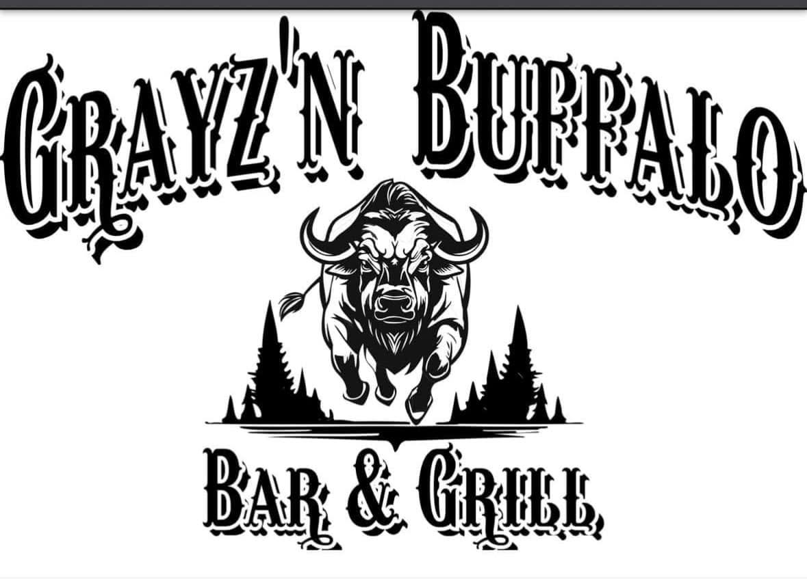
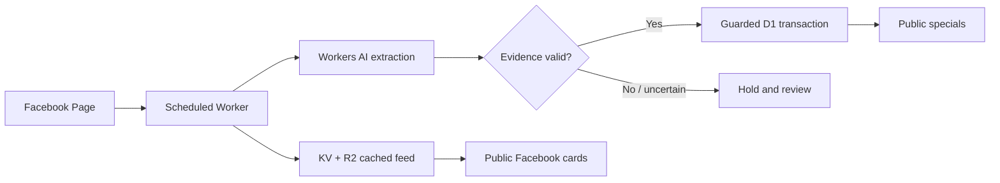
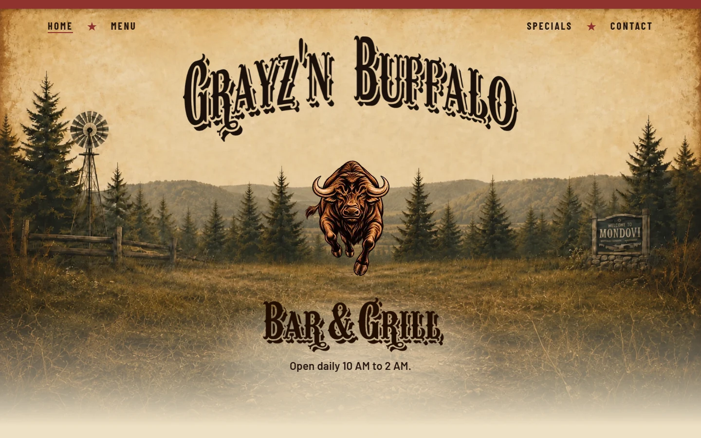
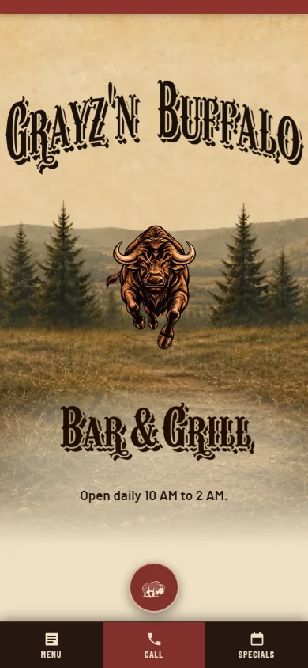
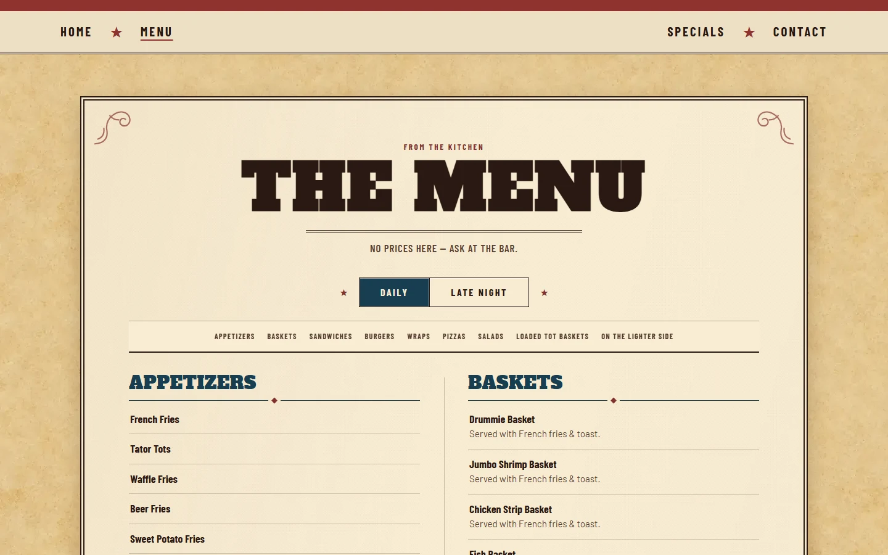
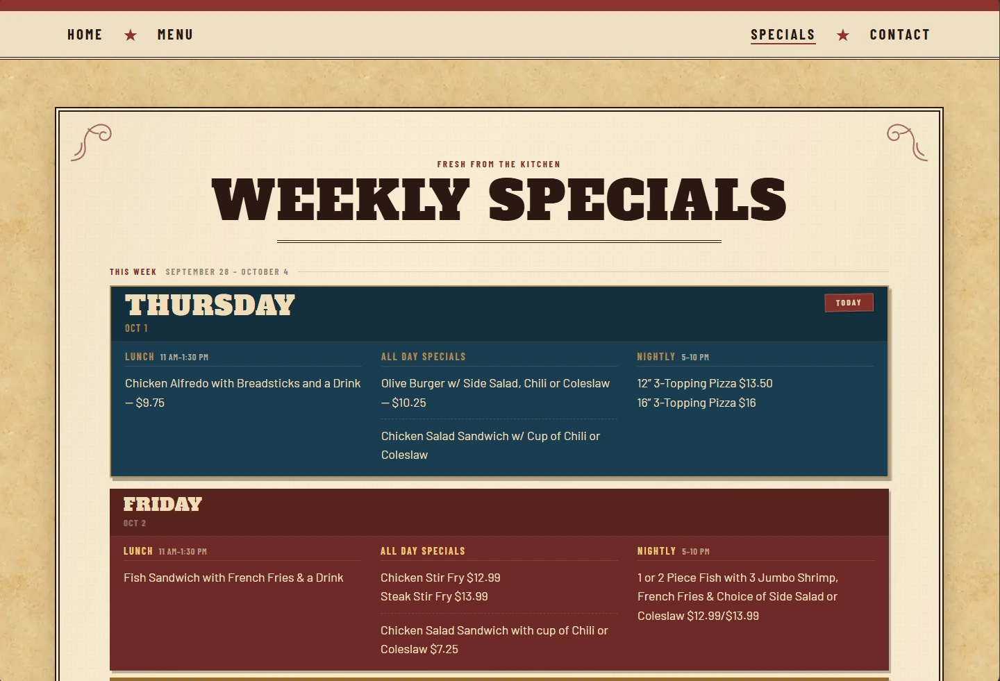

<div align="center">



# 🦬 Grayz'n Buffalo Bar & Grill

### Restaurant operations platform · AI-assisted specials · Cloudflare serverless

[](https://grayznbuffalo.com)
[](https://astro.build/)
[](https://www.cloudflare.com/)
[](https://developers.cloudflare.com/workers-ai/)


**[🌐 Live Site](https://grayznbuffalo.com)** · **[📖 Menu](https://grayznbuffalo.com/menu)** · **[👨‍💻 Developer Portfolio](https://joshuawerlein.com)**

</div>

---

## ✨ Overview

A production website and staff operations system for a Wisconsin restaurant. The public site serves menus, specials, photos, and contact information while authenticated staff manage the underlying content through a custom dashboard.

The most complex feature is a **Facebook-to-website content pipeline**: a scheduled Worker reads restaurant posts, extracts specials from images with Workers AI, verifies source evidence, and safely updates the D1 database **without guessing missing prices or overwriting newer corrections with old posts**.

## 🚀 Features

| Area | What it does |
| :--- | :--- |
| 🍔 **Restaurant menus** | D1-backed categories, daily/late-night menus, descriptions, and admin editing |
| 📅 **Weekly specials** | Date-aware schedules, recurring templates, and structured Lunch/All Day/Nightly sections |
| 🤖 **AI poster reading** | Workers AI extraction of Facebook specials images, including weekly lunch and Mexican Night formats |
| 🔄 **Guarded publishing** | Verified timestamps, source-version checks, transaction guards, audit records, and review holds |
| 📘 **Facebook feed** | Server-cached feed and images with last-known-good fallback when refreshes fail |
| 📸 **Media management** | R2-backed staff photography and responsive image delivery |
| 📊 **Staff analytics** | Authenticated traffic reporting and aggregate outbound Facebook-click counts |
| 🛡️ **Public protection** | Turnstile-verified contact forms, Resend email, sessions, input checks, and security headers |
| ♿ **Accessibility** | Keyboard-operable interfaces, focus states, reduced-motion support, and responsive layouts |

## 🔎 How the automation works



1. **Discover** eligible Page content for the correct America/Chicago date.
2. **Extract** structured dishes, prices, weekdays, and service times from source images.
3. **Validate** facts against the post/image evidence; reject ambiguous or contradictory readings.
4. **Reconcile** repeated offers and destination slots across daily, weekly lunch, and Mexican Night formats.
5. **Publish or hold** through guarded D1 updates—no fabricated prices or unsafe stale writes.

> **📌 Source-of-truth policy (November 12, 2026):** A correctly verified **newer Facebook post** can update website specials, including earlier staff edits. A staff correction made **after an unchanged or older post** remains protected from that older post. Manual locks are not permanent barriers to newer verified evidence. See [the detailed precedence rules](docs/facebook-specials-source-of-truth.md).

## 🧩 Architecture

```text
Astro 7 website + authenticated /admin
├── Cloudflare D1   → menus, specials, settings, import/audit records
├── Cloudflare KV   → admin sessions
├── Cloudflare R2   → managed restaurant photography
└── Turnstile + Resend → protected contact form

Separate Worker: workers/fb-feed/
├── Meta Graph API → source posts and media
├── Workers AI     → structured poster extraction
├── D1             → guarded and auditable specials updates
└── KV + R2        → cached public Facebook feed and images
```

The site and the Facebook Worker have **separate configuration, tests, and deployment lifecycles**.

## 📷 Screenshots

| Desktop homepage | Mobile homepage |
| :---: | :---: |
|  |  |

| Menu | Specials |
| :---: | :---: |
|  |  |

## 🛡️ Reliability and security

- Server-managed admin sessions, authorization checks, and parameterized database queries.
- Versioned SQL migrations and recovery documentation for structured restaurant content.
- Facebook feed preserves valid cached content during temporary upstream failures.
- Source hashing, timestamps, idempotency, guarded transactions, and review alerts reduce duplicate or stale updates.
- Controlled media paths, responsive delivery, and security headers.

## 💻 Development

The current `package.json` declares **Astro 7.4.7** and **Node 24**. Use the repository's configured Node version.

```bash
npm install
npm run dev
npm run build
npm run preview
```

The Facebook Worker has its own deployment and automated tests in [`workers/fb-feed/`](workers/fb-feed/). Do not rerun historical D1 migrations or redeploy the Worker just to update documentation.

<details>
<summary><strong>📚 Deep-dive documentation</strong></summary>

- [Facebook specials automation](docs/facebook-specials-auto.md)
- [Canonical source and staff-edit precedence](docs/facebook-specials-source-of-truth.md)
- [Mexican Night automation](docs/MEXICAN_NIGHT_AUTOMATION.md)
- [Menu recovery runbook](recovery/README.md)
- [Post-launch checklist](POST_LAUNCH_CHECKLIST.md)

</details>

## 📜 Copyright and authorship

This is client work shared for **portfolio review and technical evaluation**, not open-source reuse. Source code, photography, trademarks, and business content remain subject to their respective owners' rights.

**Developed and maintained by Joshua Werlein** · [Portfolio](https://joshuawerlein.com) · [GitHub](https://github.com/joshua-werlein) · [LinkedIn](https://www.linkedin.com/in/joshua-werlein)
